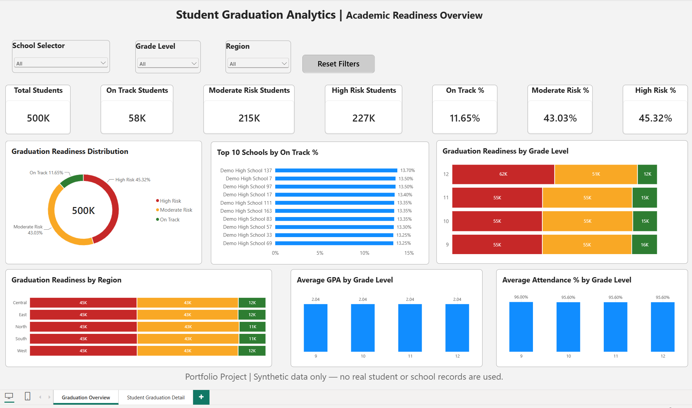
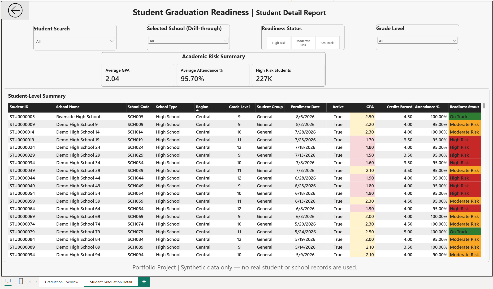
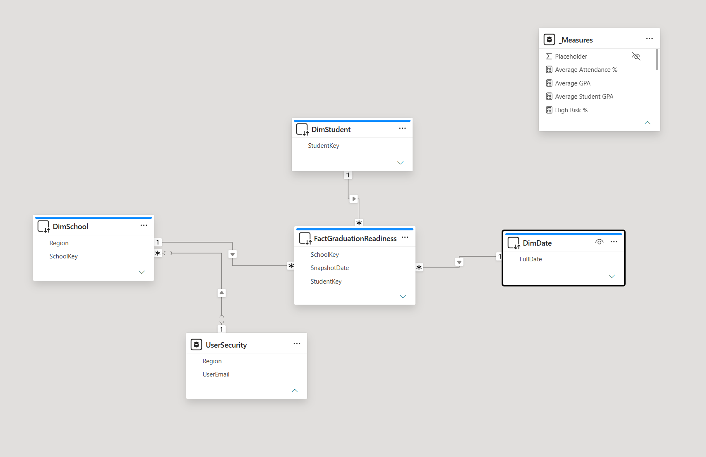

# Student Graduation Analytics | Power BI & SQL Server

An end-to-end data analytics portfolio project built with **SQL Server, Power BI, Power Query, and DAX** to analyze student graduation readiness, academic risk, attendance, GPA, and school-level performance.

The project uses a **fully synthetic education dataset containing 500,000 students**. No real student, school, or confidential educational data is used.

## Project Overview

The goal of this project is to demonstrate an end-to-end Business Intelligence workflow—from relational data preparation and validation in SQL Server to data modeling, DAX development, interactive reporting, drill-through analysis, and data validation in Power BI.

The solution enables users to analyze graduation readiness across schools, regions, and grade levels while also drilling down to individual student academic profiles.

## Dataset

The synthetic SQL Server dataset includes:

- **500,000 students**
- **250 schools**
- **5,000,000 academic performance records**
- **10,000,000 attendance records**
- **500,000 graduation readiness records**
- Grade levels 9–12
- Five geographic regions
- GPA, credits earned, attendance, enrollment, and readiness information

Graduation readiness is categorized into:

- **On Track**
- **Moderate Risk**
- **High Risk**

## Technology Stack

**Database:** SQL Server  
**Visualization:** Power BI  
**Data Transformation:** Power Query  
**Analytics:** DAX  
**Data Modeling:** Dimensional / star-schema modeling  
**Validation:** SQL reconciliation and Power BI cross-validation  
**Version Control / Portfolio:** GitHub

## Dashboard Preview

### Academic Readiness Overview



### Student Detail Report



### Academic Readiness Overview

The overview dashboard provides district-level graduation readiness analysis through:

- Total student population
- On Track, Moderate Risk, and High Risk student counts
- Graduation readiness percentages
- Graduation readiness distribution
- Top 10 schools by On Track %
- Graduation readiness by grade level
- Graduation readiness by region
- Average GPA by grade level
- Average attendance % by grade level
- School, grade, and region filtering
- Reset Filters functionality

### Student Detail Report

The Student Detail Report supports student-level investigation using:

- Student search
- School drill-through
- Readiness Status filtering
- Grade Level filtering
- Academic Risk Summary
- Average GPA
- Average Attendance %
- High Risk student count
- Student-level academic and enrollment information
- Conditional formatting for GPA and graduation readiness
- Back-button navigation to the overview dashboard

The Student Search slicer dynamically limits available students based on the active readiness and report filters.

## Drill-Through Analysis

Users can drill through from school-level visuals on the Academic Readiness Overview to the Student Detail Report.

The selected school context is passed automatically to the detail page, allowing users to investigate the students contributing to that school's graduation-readiness metrics.

## Data Model

The Power BI semantic model follows a star-schema design centered on
`FactGraduationReadiness`.

- `DimStudent` provides student attributes.
- `DimSchool` provides school, school type, and regional attributes.
- `DimDate` supports date-based analysis.
- `FactGraduationReadiness` contains GPA, credits, attendance, grade level,
  and graduation-readiness metrics.
- `_Measures` centralizes reusable DAX measures.



## Key DAX Measures

The report includes reusable measures for:
Total Students

- On Track Students
- Moderate Risk Students
- High Risk Students
- On Track %
- Moderate Risk %
- High Risk %
- Average GPA
- Average Attendance %
- Dynamic Student Search availability

Full measure documentation is available here: 

## SQL Development

SQL Server was used for relational data preparation, synthetic portfolio data generation, views, aggregation and validation.
The repository includes scripts for:
- Creating the relational tables
- Generating reproducible synthetic portfolio data
- Creating analytical views
- Reconciling SQL results against Power BI

  View SQL Scripts here: 

## Data Validation

Power BI results were validated against SQL Server queries before finalizing the dashboard.

Validated results include:

| Metric | Validated Result |
|---|---:|
| Total Students | 500,000 |
| On Track Students | 58,229 |
| Moderate Risk Students | 215,162 |
| High Risk Students | 226,609 |
| On Track % | 11.65% |
| Moderate Risk % | 43.03% |
| High Risk % | 45.32% |
| Average GPA | 2.0392 |
| Average Attendance | 95.70% |

The **Top 10 Schools by On Track %**, grade-level readiness distribution, regional readiness distribution, and individual student records were also reconciled against SQL Server.

## Example Validation

An individual student record was validated between SQL Server and Power BI:

| Attribute | Value |
|---|---|
| Student ID | STU0000001 |
| School | Lakeview High School |
| Grade Level | 9 |
| GPA | 2.30 |
| Credits Earned | 4.00 |
| Attendance | 95.00% |
| Readiness Status | Moderate Risk |

The Power BI Student Detail Report matched the SQL Server record.

## Key Analytical Findings

Using the synthetic dataset:

- **45.32%** of students are classified as High Risk.
- **43.03%** are classified as Moderate Risk.
- **11.65%** are On Track.
- Grade 12 has the largest High Risk population among the four grade levels.
- School-level On Track rates can be compared interactively through the Top 10 Schools analysis.
- Regional readiness levels are relatively consistent across the five synthetic regions.

These findings are based entirely on generated portfolio data and do not represent any real school district.

## Repository Structure

```text
student-graduation-analytics-powerbi/
│
├── README.md
│
├── powerbi/
│   └── Student-Graduation-Analytics.pbix
│
├── sql/
│   ├── 01_create_tables.sql
│   ├── 02_generate_synthetic_data.sql
│   ├── 03_create_views.sql
│   └── 04_validation_queries.sql
│
├── dax/
│   └── measures.md
│
├── screenshots/
│   ├── academic-readiness-overview.png
│   └── student-detail-report.png
│
└── docs/
    └── data-model.png
```

## Skills Demonstrated

This project demonstrates hands-on experience with:

**SQL Server • T-SQL • Power BI • DAX • Power Query • Data Modeling • Star Schema • KPI Development • Data Validation • Data Quality • Drill-Through Reporting • Conditional Formatting • Interactive Dashboard Design • Business Intelligence**


## Data Privacy

**Portfolio Project | Synthetic data only — no real student or school records are used.**

The dataset was generated specifically for demonstrating SQL, data modeling, analytics, and Power BI development skills.

## Author

**Kalyan Kalagotla**

Data Engineer | Senior BI Developer | SQL | Power BI | Azure | GCP | Databricks | PySpark | Python | Snowflake | dbt
